# MinIME

*Yet another Linux port of the WeType engine* —— 在 Linux 上原生运行微信输入法引擎的 fcitx5 输入法。

> [!WARNING]
> **测试版（0.1.2）**：MinIME 还处在早期测试阶段，可能存在大量问题，包括崩溃、输入异常和配置不兼容，
> 不建议作为唯一的输入法使用。
>
> **Beta (0.1.2)**: MinIME is at an early testing stage and may have many problems. Do not rely on it as
> your only input method. 

微信输入法官方只提供 Windows、macOS 和移动端版本。在 Linux 上使用它，常见的做法是用 Wine 运行 Windows 版、
在虚拟机里运行，或者通过 ARM 转译运行安卓版。MinIME 采用另一条路线：**尽可能把每个组件都做成 Linux 原生程序**。

- **引擎原生装载**：本项目实现了一个 PE 装载器和精简的 Win32 兼容层，把官方 Windows x64 引擎（`libwxhld.dll`）
  直接装进 Linux 进程运行。引擎的机器码原样执行，不经过 Wine、虚拟机或指令转译。
- **网络协议原生重写**：跨设备同步所需的网络栈（WebSocket、ECDH 握手、AES 加密、请求签名）由 Rust 从协议层重新实现。
- **模型推理原生重写**：整句模型和离线语音只使用官方的模型文件，推理代码由本项目（C / Vulkan）和开源（Rust）实现。

因此 MinIME 的延迟和内存占用都低于 Wine 方案（见[性能](#性能)），代价是**只支持 x86-64（amd64）平台**——
引擎是 x86-64 机器码，装载器不做指令转译。

> 本项目与腾讯无关，仓库和软件包都不包含任何腾讯的程序、词库或模型。安装后由 `minime-fetch` 从腾讯官方地址
> 下载安装包，校验后解包到用户本机。使用前请阅读[声明](#声明)。

## 功能

**输入**

- 候选、词库、用户词库和学习都由官方引擎完成，与官方客户端一致。
- **整句候选**（标 `✦`）：用官方整句模型按拼音约束解码，结合光标前的上文区分「经理 / 经历」这类同音词；
  选中的整句会写回引擎的用户词库。优先使用 GPU（Vulkan），没有可用 GPU 时使用 CPU。
- **输入方案**：全拼；七种双拼（小鹤、自然码、微软、搜狗、紫光、拼音加加、智能 ABC）；
  五笔 86 / 98 / 新世纪（可选顶字、四码唯一上屏、拼音混输）。整句候选和云输入只用于全拼。
- 简拼、14 项模糊音、繁体输出、中英文标点切换、中英混输（`woyongiPhone` → 我用iPhone）、
  中英文之间自动加空格、Emoji 与颜文字候选、日期和时间候选、删除误学的词。
- **离线语音**：按住右 Alt 说话，松开上屏，完全在本机识别。
- 密码框不经过输入法。

**跨设备**（可选，默认关闭，不联网）

- 用 6 位匹配码与手机上的微信输入法关联，不需要登录微信。
- 剪贴板双向同步（文本和图片）、常用语同步、个人词库同步。
- 换机助手：扫码把手机上的个人词库迁移到本机。
- 云输入（实验，默认关闭）：带回云端候选（标 `☁`）。

**设置程序**

- 「MinIME 设置」提供输入方案、候选、语音、词库、模型、跨设备等全部选项，以及各个后台服务的状态和重启按钮。

候选框外观沿用 fcitx5 的主题设置，本项目不附带主题。

## 架构

```mermaid
flowchart TB
    app["应用程序"] <--> fcitx["fcitx5"] <--> addon["fcitx5-minime<br/>前端插件（C++）"]
    settings["MinIME 设置<br/>（Rust / GPUI）"]

    subgraph engined["minime-engined（C）"]
        direction TB
        loader["PE 装载器 + Win32 兼容层"] --> dll["官方引擎 libwxhld.dll<br/>（来自 Windows 安装包）"]
        dll --> netcompat["网络兼容层<br/>（替代 ime_net.dll）"]
        e2e["整句模型推理（CPU / Vulkan）<br/>模型来自 macOS 安装包"]
    end

    asrd["minime-asrd（Rust）<br/>离线语音，按需启动<br/>模型来自官方语音模型包"]
    netd["minime-netd（Rust）<br/>WebSocket · ECDH · AES · 签名"]
    server(["微信输入法服务器"])

    addon <-->|"Unix socket"| engined
    addon <-->|"Unix socket"| asrd
    netcompat <-->|"Unix socket"| netd
    settings <-->|"控制 socket"| netd
    netd <-->|"WSS / HTTPS<br/>仅在开启联网后"| server

    classDef official fill:#fff4e5,stroke:#e8a33d,color:#5c3b00
    class dll official
```



图中橙色的官方引擎是唯一运行的腾讯程序，其余组件都由本项目或开源实现；所有官方文件都在安装时从腾讯下载到本机。

| 组件 | 语言 | 作用 |
|---|---|---|
| `minime-engined` | C | 常驻的引擎服务。`loader/` 实现 PE 装载、重定位、导入解析和引擎用到的那部分 Win32 API（内存、文件、线程、同步、时间等），让官方 DLL 在 Linux 进程里直接运行；同时负责整句模型推理，以及把引擎的网络请求转交给 netd。 |
| `fcitx5-minime` | C++ | fcitx5 前端：把按键、光标前后的文字交给 engined，显示候选和预编辑；处理标点、中英文切换、长按说话等本地逻辑。 |
| `minime-netd` | Rust | 从协议层重新实现的官方网络栈：设备关联、剪贴板、常用语、个人词库同步、换机助手、云输入。只在配置里开启联网后才会连接服务器，并按白名单放行引擎的请求。 |
| `minime-asrd` | Rust | 离线语音识别服务，由 systemd socket 按需启动、空闲后自动退出；识别基于开源实现 [wechat-asr-gpu](https://github.com/Enter-tainer/wechat-asr-gpu)。 |
| MinIME 设置 | Rust（GPUI） | 图形设置程序。所有组件共用一份配置文件 `minime.conf`，设置程序和 fcitx5 自带的配置界面都读写它，改动即时生效。 |

## 性能

以下是在一台 x86-64 笔记本（AMD Ryzen，Radeon 780M 核显）上的实测，详细数据见
[engine](docs/engine.md) 和 [whole-sentence](docs/whole-sentence.md)。

| 指标 | MinIME（原生装载） | Wine 运行官方引擎 |
|---|---|---|
| 一次按键的往返延迟（按键发出到收到候选，平均） | 约 3.3 ms | 约 5.2 ms |
| 引擎服务的内存占用 | 约 245 MB | 约 330 MB（含 wineserver 和桥接进程） |
| 引擎启动（装载、初始化、加载词库） | 150–180 ms | 约 250 ms |

- 整句模型逐键解码：Vulkan（核显）约 12 ms，CPU（8 线程）约 44 ms。
- 原生装载之所以更快，主要来自三点：没有 Wine 的系统调用转换和 wineserver 往返；
  堆分配直接使用原生分配器（jemalloc）；进程间通信是本机 Unix socket，没有额外的桥接进程。
  引擎本身的计算量不变，所以剩余的时间基本都是引擎自己的计算。

## 安装

需要 x86-64 Linux、fcitx5 和 systemd。整个过程分四步：装软件包 → 把 fcitx5 设为输入法 → 运行 `minime-fetch` → 切换使用。

### 1. 安装软件包

从 [Releases](https://github.com/viewv/minime/releases) 下载对应发行版的软件包（软件包只包含 MinIME 自己的程序）：

| 发行版 | 文件 | 安装 |
|---|---|---|
| Arch Linux | `minime-git-*.pkg.tar.zst` | `sudo pacman -U minime-git-*.pkg.tar.zst` |
| Debian 13 | `minime_*debian13_amd64.deb` | `sudo apt install ./minime_*debian13_amd64.deb` |
| Ubuntu 26.10 | `minime_*ubuntu26.10_amd64.deb` | `sudo apt install ./minime_*ubuntu26.10_amd64.deb` |
| Fedora 44 | `minime-*.fc44.x86_64.rpm` | `sudo dnf install ./minime-*.fc44.x86_64.rpm` |

MinIME 只支持当前的发行版：fcitx5 插件用到较新的 fcitx5 接口，太旧的 fcitx5（例如 Ubuntu 24.04 自带的）不支持。
建议同时装上 fcitx5 的配置工具和 Qt / GTK 模块（软件包会推荐安装）：Fedora 和 Arch 是
`fcitx5-configtool fcitx5-qt fcitx5-gtk`，Debian / Ubuntu 是 `fcitx5-config-qt fcitx5-frontend-qt6 fcitx5-frontend-gtk3 fcitx5-frontend-gtk4`。

<details>
<summary>从源码构建</summary>

构建需要 gcc、cmake、较新的 Rust stable（发行版自带的版本太旧时用 [rustup](https://rustup.rs) 安装）、
fcitx5 的开发文件、shaderc（`glslc`）和 Vulkan 头文件；构建时 cargo 需要联网下载依赖。各发行版的依赖包名见
[packaging](docs/packaging.md)。

```bash
# Arch Linux
cd packaging/arch && makepkg -si
# Debian / Ubuntu
make && packaging/deb/build-deb.sh && sudo apt install ./dist/minime_*.deb
# Fedora
mkdir -p ~/rpmbuild/SOURCES
git archive --prefix=minime-$(cat VERSION)/ -o ~/rpmbuild/SOURCES/minime-$(cat VERSION).tar.gz HEAD
rpmbuild -bb packaging/rpm/minime.spec && sudo dnf install ~/rpmbuild/RPMS/x86_64/minime-*.rpm
# 其他发行版（运行时需要 fcitx5、jemalloc、python3、7z 和 curl）
make && sudo make install PREFIX=/usr
```

</details>

### 2. 把 fcitx5 设为输入法

- **KDE Plasma（Wayland）**：「系统设置 → 键盘 → 虚拟键盘」里选择 **Fcitx 5**，然后注销重新登录。
  KDE 上不需要设置 `GTK_IM_MODULE`、`QT_IM_MODULE` 这类环境变量，也不要装 Fedora 的 `fcitx5-autostart`
  （装了 fcitx5 会弹出环境变量的警告）；不要手动启动 fcitx5，它必须由 KWin 启动。
- **其他桌面**：Debian / Ubuntu 运行 `im-config -n fcitx5`，Fedora 安装 `fcitx5-autostart`，Arch 见
  [ArchWiki：Fcitx5](https://wiki.archlinux.org/title/Fcitx5)，然后注销重新登录。
  GNOME 还需要安装「Input Method Panel」扩展才能显示候选框。（GNOME 上还没有充分测试。）

登录后托盘里出现键盘图标，就说明 fcitx5 在运行了。

### 3. 运行 `minime-fetch`

以普通用户身份运行（不要加 sudo）：

```bash
minime-fetch
```

它会依次：

1. 从腾讯官方下载引擎和词库（约 218 MB）、整句模型（约 78 MB），校验后解包到 `~/.local/share/minime/official/`。
   整句模型的下载服务器比较慢，可能要几分钟，下载时会显示进度；
2. 启用并启动引擎服务 `minime-engined`；
3. 把 MinIME 加进 fcitx5 的输入法列表。

可选功能：

```bash
minime-fetch voice                              # 离线语音（约 103 MB），装好后按住右 Alt 说话
systemctl --user enable --now minime-netd       # 跨设备和云输入；之后在「MinIME 设置 → 跨设备」里打开联网
```

`minime-fetch status` 查看下载了哪些文件；`minime-fetch setup` 只重做第 2、3 步（例如升级之后）。

### 4. 开始使用

在任意输入框里按 **Ctrl+Space** 切换到 MinIME（托盘图标变成 **M**），就可以打字了。
可以打一句长句试试整句候选，例如 `tabashoujiwangzaichuzucheshangle`，候选里带 ✦ 的「他把手机忘在出租车上了」
就是整句模型给的。设置在应用菜单的「MinIME 设置」里。

### 常见问题

| 现象 | 处理 |
|---|---|
| 托盘里只有键盘，Ctrl+Space 切不到 MinIME | 运行 `minime-fetch setup` 把 MinIME 加进列表；或在 fcitx5 配置里添加，系统是英文时要先取消勾选「Only Show Current Language」（MinIME 是中文输入法，默认被筛掉） |
| 切到了 MinIME，但打字没有候选框 | 引擎服务没在运行：`minime-fetch status` 确认引擎已下载，再运行 `minime-fetch setup`；日志：`journalctl --user -u minime-engined -b` |
| 没有 ✦ 整句候选 | `minime-fetch status` 确认整句模型已下载，然后 `minime-fetch setup` 重启引擎。整句候选只在输入较长、和引擎首选不同时出现 |
| fcitx5 弹出 `GTK_IM_MODULE` / `QT_IM_MODULE` 的警告（KDE） | 卸载 `fcitx5-autostart`，或去掉自己设置的这两个环境变量，注销重新登录 |
| 跨设备显示「official files missing」 | 先运行 `minime-fetch`：联网功能要用下载的官方文件 |

### 官方文件的版本是固定的

MinIME 和官方引擎之间的适配（引擎接口、会话配置、装载时的兼容处理）是针对特定版本做的，
所以 `minime-fetch` 只下载下面这几个版本，并逐个校验，校验不通过就拒绝使用：

| 文件 | 版本 | 校验 |
|---|---|---|
| Windows 安装包（引擎、词库） | 微信输入法 Windows 版 3.0.1.35（`WeTypeSetup_3.0.1.35_3.exe`） | SHA-256 |
| macOS 安装包中的整句模型 | 微信输入法 macOS 版 3.0.1（`WeType_3.0.1_684.zip`） | 每个文件 MD5 |
| 离线语音模型 | 官方语音资源包 `ime_asr_decoder_model`（2026-07 版） | MD5 |

官方发布新版本不会影响 MinIME：已经下载的文件一直可用，新版本要等 MinIME 验证适配后才会切换。
如果官方以后撤下了这些下载地址，可以用自己保存的安装包离线安装：
`minime-fetch engine --from WeTypeSetup_3.0.1.35_3.exe`。

## 使用

在应用菜单里打开 **MinIME 设置**：

- 「输入」：输入方案、整句候选、繁体、标点、表情、语音、模糊音等；
- 「跨设备」：开启联网后关联手机（手机端在微信输入法的「跨设备粘贴和同步」里输入匹配码），以及同步和换机助手；
- 「常用语」「词库」「模型」：管理常用语、词库和模型；
- 「关于」：查看各个后台服务的状态，必要时一键重启。

**已知限制**：引擎内部抛出异常时引擎服务会退出，由 systemd 在一秒内自动重启，正在输入的内容会丢失。

接下来的计划见 [路线图](ROADMAP.md)。

## 开发

```bash
make                                                  # 构建全部组件
python3 scripts/engined_test.py "nihao <SEL:0>"       # 不经过 fcitx5，直接驱动引擎服务
(cd netd && cargo test)                               # 协议实现与参考向量对照
```

构建、开发时直接运行、测试工具和调试开关见 [development](docs/development.md)。

## 文档

| 文档 | 内容 |
|---|---|
| [architecture](docs/architecture.md) | 整体架构、一次按键的路径、文件和目录 |
| [engine](docs/engine.md) | 引擎的原生装载和性能 |
| [input](docs/input.md) | 输入功能、按键和配置项 |
| [whole-sentence](docs/whole-sentence.md) | 整句候选 |
| [voice](docs/voice.md) | 离线语音输入 |
| [dictionaries](docs/dictionaries.md) | 词库与学习 |
| [cross-device](docs/cross-device.md) | 跨设备功能 |
| [privacy](docs/privacy.md) | 隐私：哪些数据留在本机、哪些会发给服务器 |
| [packaging](docs/packaging.md) | 打包和安装布局 |
| [development](docs/development.md) | 构建、测试和调试 |
| [ROADMAP](ROADMAP.md) | 路线图 |

## 声明

- **个人社区项目**：本项目由个人业余维护，非商业性质，与腾讯公司及微信输入法团队**没有任何关联**，
  也未获得其授权或认可。「微信」「微信输入法」「WeType」是腾讯公司的商标，本项目仅用于说明兼容对象。
- **不分发腾讯的文件**：仓库和发布的软件包均不包含腾讯的程序、词库或模型。所需的官方安装包由 `minime-fetch`
  从腾讯官方地址下载到用户本机，校验后解包。使用这些文件须遵守腾讯的软件许可及服务协议，是否使用由用户自行决定。
- **以互操作为目的**：本项目旨在让用户在 Linux 上使用其从官方渠道取得的输入法引擎，不提供破解，
  也不绕过任何付费或授权限制。
- **联网功能默认关闭**：开启后将与腾讯服务器通信，行为与官方客户端相同，请自行判断是否开启。
- **不作担保**：本软件按「原样」提供，不保证适用于任何用途，也不对使用后果承担责任（见许可证第 6、7 条）。
- **联系方式**：如果您是相关权利人（包括腾讯公司），认为本项目存在不妥之处，请在本仓库提交 Issue。
  我们会尽快回复，并在必要时修改或删除相关内容。

> **Disclaimer.** MinIME is a personal, non-commercial community project. It is not affiliated with,
> authorized or endorsed by Tencent. "WeChat", "WeType" and "微信输入法" are trademarks of Tencent and are
> used here only to describe compatibility. Neither this repository nor its packages contain any Tencent
> binaries, dictionaries or models; the `minime-fetch` tool downloads the official packages from Tencent's own
> servers onto the user's machine, and their use is subject to Tencent's terms. Network features are off by
> default. The software is provided "as is", without warranty of any kind. If you are a rights holder and
> have any concern, please open an issue — it will be answered promptly, and content will be changed or
> removed if needed.

## AI disclosure

This project was built with [Claude Code](https://claude.com/claude-code), Anthropic's AI coding agent.
Essentially all of the code, scripts and documentation in this repository — the PE loader and Win32 compatibility
layer, the engine service, the whole-sentence model inference, the network protocol implementation, the fcitx5
add-on, the settings app and the packaging — were written by Claude Code, working under the direction of the
maintainer, who set the goals, made the design decisions, and tested the results on real hardware.

Please keep this in mind when reading or reusing the code: it has been exercised in daily use and in the tests
described in the docs, but it has not had an independent line-by-line human review. Bug reports and reviews are
very welcome.

## 许可

本项目的原创代码以 [Mozilla Public License 2.0](LICENSE)（MPL-2.0）授权。您可以自由使用、修改和再分发；
再分发经过修改的本项目源文件时，须以同一许可证公开这些文件的源代码。

MPL-2.0 仅适用于本项目的原创代码。安装时从腾讯下载的文件受腾讯相关条款约束，第三方依赖遵循各自的许可证。

## 致谢

- 设置程序基于 [GPUI](https://github.com/zed-industries/zed) 和 [gpui-kit](https://github.com/longbridge/gpui-kit)，
  图标来自 [Lucide](https://lucide.dev)（ISC 许可）。
- 离线语音识别基于 [wechat-asr-gpu](https://github.com/Enter-tainer/wechat-asr-gpu)（MIT 许可）。
